<div align="center">
  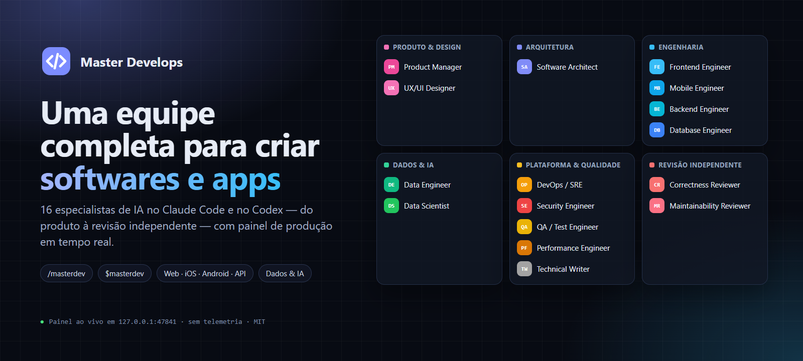
</div>

<h1 align="center">Master Develops</h1>

<p align="center">
  <strong>Uma equipe completa de IA para criar softwares e aplicativos sofisticados — dentro do Claude Code e do Codex.</strong><br/>
  Produto, design, arquitetura, web, mobile, backend, banco de dados, engenharia e ciência de dados, DevOps, segurança, QA, performance, documentação e revisão independente — com um painel de produção em tempo real.
</p>

<p align="center">
  <a href="https://github.com/carlos-dataengineer/master-develops-software-app/actions/workflows/ci.yml"></a>
  
  
  
  
  
  
</p>

<p align="center">
  <a href="#-instalação-em-um-comando">Instalação</a> ·
  <a href="#-como-usar">Como usar</a> ·
  <a href="#-a-equipe">A equipe</a> ·
  <a href="#-painel-de-produção">Painel</a> ·
  <a href="#-como-a-equipe-trabalha">Como trabalha</a> ·
  <a href="#-perguntas-frequentes">FAQ</a>
</p>

---

## ⚡ Em 30 segundos

```powershell
# Windows (PowerShell)
irm https://raw.githubusercontent.com/carlos-dataengineer/master-develops-software-app/main/install.ps1 | iex
```

```bash
# macOS / Linux
curl -fsSL https://raw.githubusercontent.com/carlos-dataengineer/master-develops-software-app/main/install.sh | bash
```

Um comando e pronto:

1. a skill **`masterdev`** e os **16 especialistas** são instalados no **Claude Code** e no **Codex**;
2. o **Painel de produção** é gerado na sua máquina e **abre no navegador**;
3. no Claude Code, hooks passam a registrar sozinhos cada especialista que começa ou termina uma tarefa.

Depois, abra uma sessão nova e digite **`/masterdev`** (Claude Code) ou **`$masterdev`** (Codex).

<p align="center">
  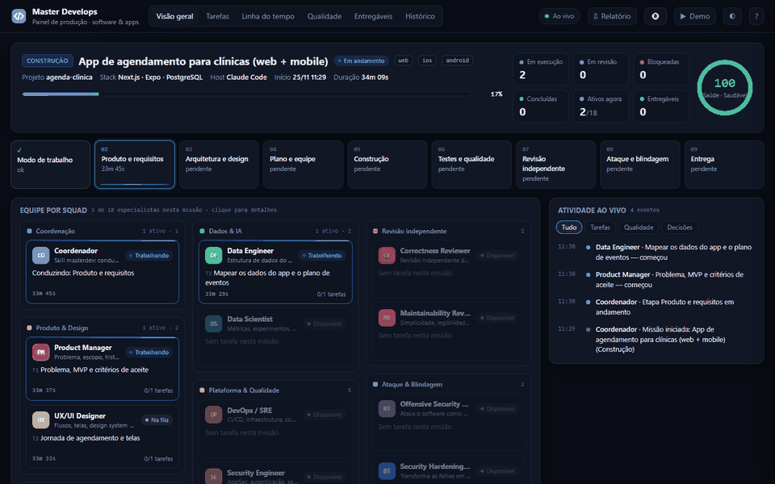
  <br/><sub>Uma missão fictícia do começo ao fim: etapas avançando, especialistas trabalhando em paralelo, testes reprovando e sendo corrigidos, revisão encontrando achados.</sub>
</p>

## 🧭 O que é

O **Master Develops** transforma o seu Claude Code ou Codex numa **equipe sênior de desenvolvimento de produto**. Em vez de conversar com um assistente genérico, você aciona um **coordenador** que entende o problema, convoca só os especialistas necessários, divide o trabalho com escopo e arquivos separados, integra os resultados, garante **revisão independente** e entrega com **evidências reais** — build, testes, verificações e o app rodando.

Serve para **sites e apps web, aplicativos iOS e Android, APIs e serviços, sistemas internos, ferramentas de linha de comando e produtos com dados e IA**.

| | |
|---|---|
| 🧑‍✈️ **Um ponto de entrada** | `/masterdev` pergunta o modo (construir, evoluir, revisar, depurar) e conduz o resto |
| 👥 **16 especialistas em 6 squads** | Produto & Design, Arquitetura, Engenharia, Dados & IA, Plataforma & Qualidade e Revisão independente |
| 📺 **Painel de produção** | Etapas, tarefas e dependências, entregáveis, gates de qualidade, achados, ADRs e índice de saúde — ao vivo |
| ✅ **Prova, não promessa** | Só conta como aprovado o que foi executado de verdade; revisores independentes em modo somente leitura |
| 🧠 **Memória contextual** | Lembra convenções e decisões confirmadas, isoladas por projeto |
| 🔒 **Local e seguro** | Sem telemetria; painel só em `127.0.0.1`; deploy, publicação e ações destrutivas só com sua autorização |
| 🔁 **Claude Code e Codex** | A mesma equipe nos dois hosts, cada um no seu formato nativo |

## 📦 Instalação em um comando

**Pré-requisitos:** Python 3.10+ e o Claude Code e/ou o Codex instalados. Nenhuma biblioteca extra.

<p align="center">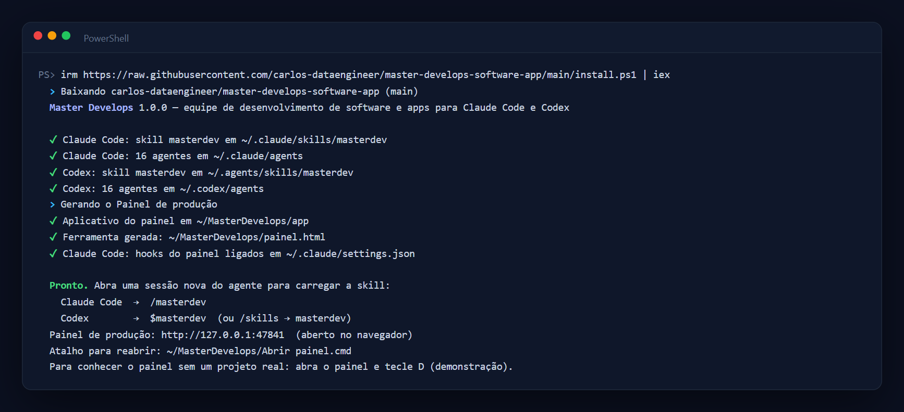</p>

### O que a instalação cria

| Onde | O quê |
|---|---|
| `~/.claude/skills/masterdev/` | Skill coordenadora para o Claude Code (playbooks, definição de pronto, painel e memória) |
| `~/.claude/agents/*.md` | Os 16 especialistas no formato do Claude Code |
| `~/.agents/skills/masterdev/` | Skill para o Codex (com `agents/openai.yaml` para o menu `/skills`) |
| `~/.codex/agents/*.toml` | Os 16 especialistas no formato do Codex |
| `~/.claude/settings.json` | 2 hooks (`PreToolUse`/`PostToolUse` da ferramenta de subagentes), com cópia em `settings.json.bak-mdv` |
| `~/MasterDevelops/painel.html` | O painel em um arquivo único (foto da última missão + demonstração) |
| `~/MasterDevelops/Abrir painel.cmd` · `abrir-painel.sh` | Atalho para reabrir o painel ao vivo |
| `~/MasterDevelops/board/` | Histórico de missões (eventos locais, só textos curtos) |

### Opções

| Windows (`$env:...` antes do comando) | macOS/Linux (`... \| bash -s -- <opção>`) | Efeito |
|---|---|---|
| `MDV_SKIP_CLAUDE=1` | `--skip-claude` | Não instala no Claude Code |
| `MDV_SKIP_CODEX=1` | `--skip-codex` | Não instala no Codex |
| `MDV_NO_HOOKS=1` | `--no-hooks` | Não altera o `settings.json` (o painel segue funcionando pelo coordenador) |
| `MDV_NO_OPEN=1` | `--no-open` | Não abre o navegador |
| `MASTERDEV_HOME=D:\MDV` | `--home <pasta>` | Outra pasta para o painel e o histórico |
| `MDV_REF=v1.0.0` | `--ref v1.0.0` | Instala uma versão específica |

Com o repositório clonado:

```powershell
.\install.ps1                                   # instala para o seu usuário
.\install.ps1 -Project C:\caminho\do\projeto    # instala só em um projeto
.\install.ps1 -Uninstall                        # remove (mantém histórico e memória)
.\install.ps1 -Uninstall -Purge                 # remove também o histórico do painel
```

<details>
<summary><b>Alternativa: marketplace de plugins do Claude Code</b></summary>

```text
/plugin marketplace add carlos-dataengineer/master-develops-software-app
/plugin install masterdev@master-develops
```

Nesse caminho o comando fica `/masterdev:masterdev` e os hooks automáticos não são ligados; o painel funciona pelos registros do coordenador. Para a experiência completa, prefira o instalador.
</details>

**Atualizar** = rodar o mesmo comando de novo. O instalador só substitui o que ele mesmo instalou; skills ou agentes de mesmo nome vindos de outra origem são preservados (use `--force`/`-Force` para substituir). Convive com o [Master Data Engineer](https://github.com/carlos-dataengineer/master-data-engineer) na mesma máquina.

## 🚀 Como usar

### 1. Acione a equipe

| Host | Comando |
|---|---|
| **Claude Code** | `/masterdev` |
| **Codex** | `$masterdev` ou `/skills` → `masterdev` |
| **Só abrir o painel** | `/masterdev painel` |

### 2. Escolha o modo

Toda ativação começa com a mesma pergunta — a equipe **não mexe em arquivos antes da sua resposta**:

| Modo | Quando usar | O que a equipe faz |
|---|---|---|
| **1. Construir** | Software ou app novo | Descoberta → arquitetura → plano → construção em paralelo → qualidade → revisão → entrega |
| **2. Evoluir** | Nova funcionalidade, melhoria ou refatoração | Lê convenções, mapeia o impacto, remove o obsoleto, constrói, testa e revisa |
| **3. Revisar** | Código, PR, app, arquitetura, segurança | Revisões independentes em paralelo; achados com severidade, arquivo:linha e cenário |
| **4. Depurar** | Bug ou falha | Reproduz, encontra a causa raiz, corrige com a menor mudança e cria teste de regressão |

### 3. Acompanhe no painel e receba a entrega

Ao final você recebe: **resultado**, **como rodar**, **decisões** (ADRs), **arquivos** tocados, **validações executadas com o resultado real**, e **pendências e riscos**.

Exemplos de pedidos em [`docs/casos-de-uso.md`](docs/casos-de-uso.md).

## 👥 A equipe

| Squad | Especialistas |
|---|---|
| 🎨 **Produto & Design** | `product-manager` · `ux-ui-designer` |
| 🏛️ **Arquitetura** | `software-architect` |
| 🛠️ **Engenharia** | `frontend-engineer` · `mobile-engineer` · `backend-engineer` · `database-engineer` |
| 📊 **Dados & IA** | `data-engineer` (estrutura e fluxo dos dados do app, eventos, pipelines) · `data-scientist` (métricas, experimentos, ML e LLM) |
| 🚦 **Plataforma & Qualidade** | `devops-sre-engineer` · `security-engineer` · `qa-test-engineer` · `performance-engineer` · `technical-writer` |
| 🔍 **Revisão independente** | `code-correctness-reviewer` · `code-maintainability-reviewer` (somente leitura) |

No Codex os nomes usam sublinhado (`backend_engineer`). Papel e instruções de cada um em [`docs/agents.md`](docs/agents.md). Toda a equipe vem de um único arquivo, [`team.json`](masterdev/skills/masterdev/assets/team.json).

## 📺 Painel de produção

Roda só na sua máquina, em `http://127.0.0.1:47841`, e se atualiza sozinho enquanto a equipe trabalha.

<p align="center">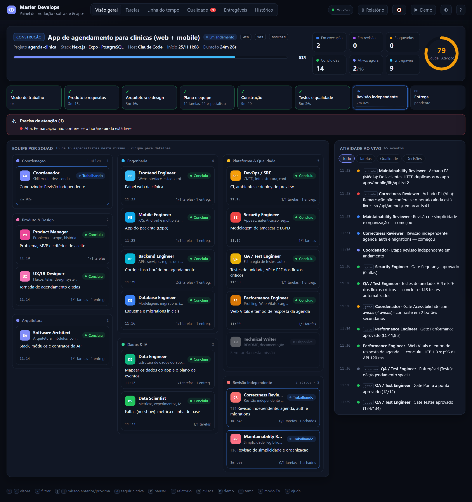</p>

| Tecla | Visão | |
|---|---|---|
| `1` | **Visão geral** | Missão, progresso, índice de saúde, 8 etapas, "Precisa de atenção", equipe por squad, atividade ao vivo |
| `2` | **Tarefas** | Quadro com dependências entre tarefas e filtro por squad |
| `3` | **Linha do tempo** | Faixa de etapas + uma linha por especialista |
| `4` | **Qualidade** | Gates (build, lint, tipos, testes, E2E, cobertura, segurança, acessibilidade, performance) e achados de revisão |
| `5` | **Entregáveis** | Arquivos produzidos por tipo e decisões de arquitetura (ADRs) |
| `6` | **Histórico** | Métricas de produção, missões por modo, especialistas mais acionados |

| Qualidade | Entregáveis |
|---|---|
| 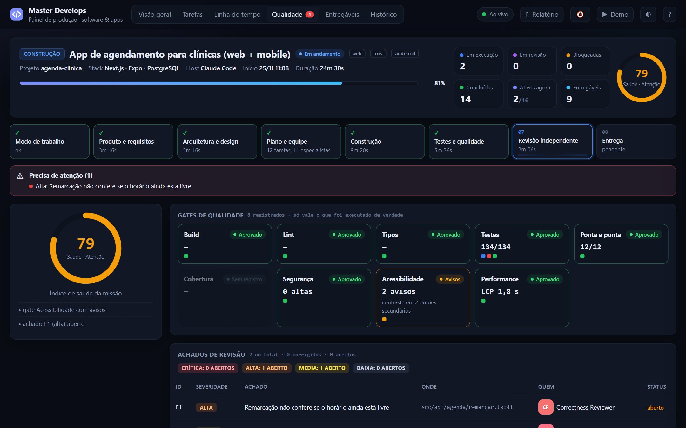 | 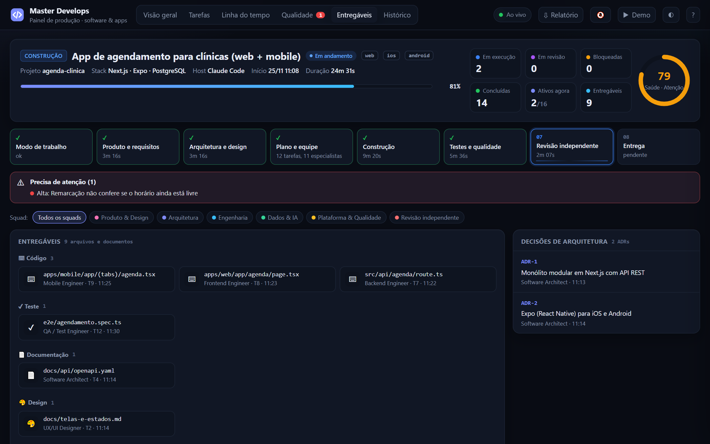 |

| Tarefas com dependências | Linha do tempo |
|---|---|
| 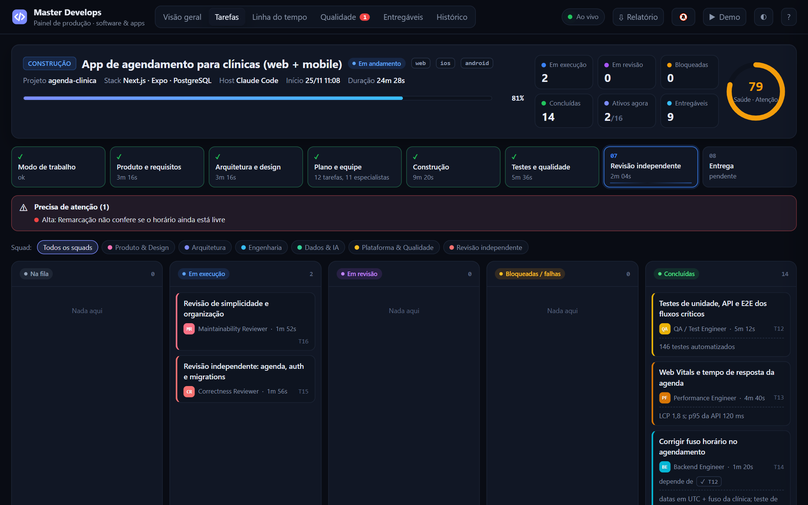 | 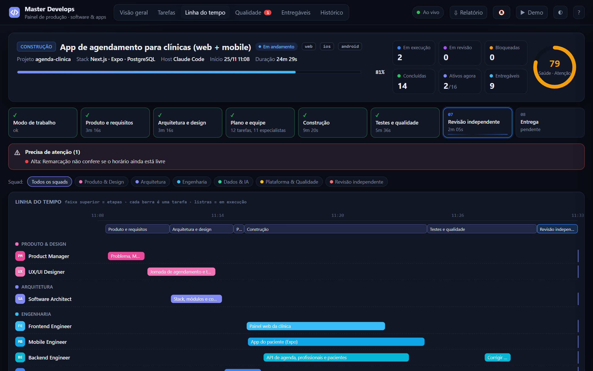 |

| Detalhes do especialista | Histórico | Celular |
|---|---|---|
| 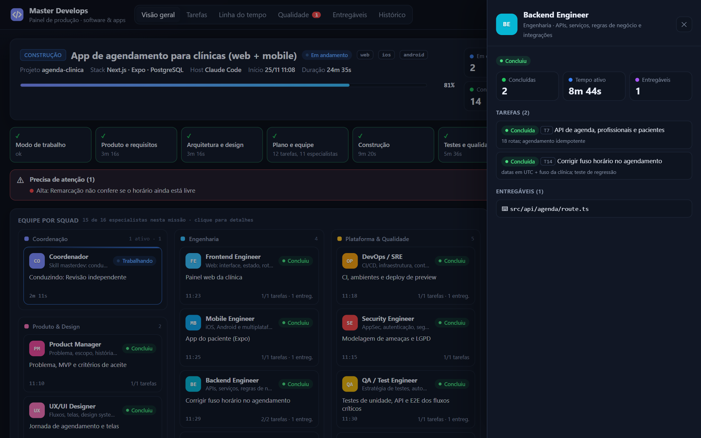 | 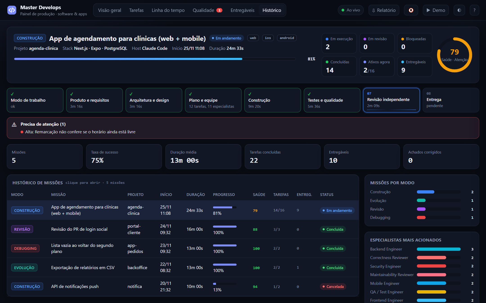 | 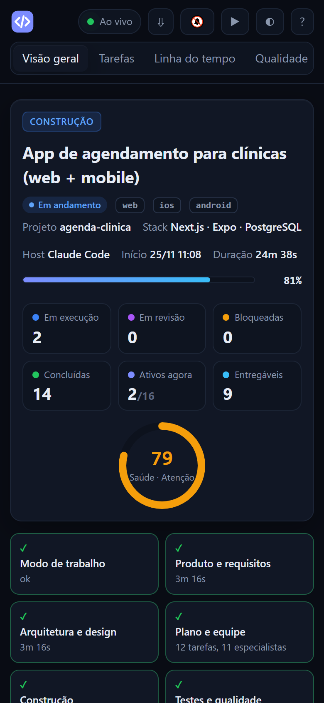 |

**Mais:** relatório da missão em Markdown (tecla `E` ou `team_board.py report`), avisos do navegador para bloqueios e falhas (`N`), tema claro/escuro (`T`), modo TV (`F`), filtro (`/`) e demonstração (`D`). Tudo em [`docs/painel.md`](docs/painel.md), incluindo o que mudou em relação ao painel do Master Data Engineer.

## ⚙️ Como a equipe trabalha

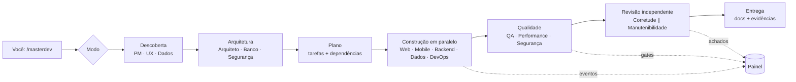

Princípios que guiam todos os especialistas:

- **Problema antes da solução** e nada de requisitos inventados.
- **Domínio e dados primeiro**, depois interface e implementação.
- **A menor solução completa**: reaproveitar o que existe, sem abstrações para o futuro, mas terminando tudo que a mudança exige.
- **Experiência e acessibilidade** (WCAG 2.2 AA) e **segurança e privacidade** (OWASP, LGPD) fazem parte do pronto.
- **Um escritor por arquivo**, paralelismo só no que é independente.
- **Prove que funciona**: build, testes e app rodando; nunca declarar sucesso sem evidência.
- **Causa raiz** em bugs, **revisão independente** em toda entrega.

Detalhes: [arquitetura](docs/architecture.md) · [playbooks](masterdev/skills/masterdev/references/PLAYBOOKS.md) · [definição de pronto](masterdev/skills/masterdev/references/DEFINITION-OF-DONE.md) · [protocolo do painel](masterdev/skills/masterdev/references/BOARD-PROTOCOL.md) · [memória contextual](docs/contextual-learning.md).

## 🧬 De onde veio

O projeto foi desenhado a partir do estudo de três modelos públicos de agentes de código e do Master Data Engineer:

| Modelo | O que trouxe |
|---|---|
| **Pstack** | Skill de entrada com playbooks e princípios de engenharia |
| **Thermos** | Revisão dupla e independente em paralelo |
| **Ponytail** | A menor mudança completa, sem cortar segurança nem acessibilidade |
| **Master Data Engineer** | Painel em tempo real, instalador de um comando, memória contextual |

O mapeamento item por item está em [`docs/mapeamento-dos-modelos.md`](docs/mapeamento-dos-modelos.md). Nenhum arquivo dos modelos é redistribuído; veja [`THIRD_PARTY_NOTICES.md`](THIRD_PARTY_NOTICES.md).

## 🗂️ Estrutura do repositório

```text
master-develops-software-app/
├── install.ps1 · install.sh          instaladores de um comando
├── masterdev/                         o pacote (plugin Claude Code / Codex)
│   ├── skills/masterdev/
│   │   ├── SKILL.md                   o coordenador
│   │   ├── references/                playbooks, definição de pronto, protocolo do painel, memória
│   │   ├── scripts/                   team_board.py (painel) · contextual_memory.py (memória)
│   │   └── assets/                    painel.html · team.json (fonte única da equipe)
│   ├── agents/                        16 agentes Claude Code (gerados)
│   ├── .codex/agents/                 16 agentes Codex (gerados)
│   └── tests/                         validação do pacote, painel e memória
├── scripts/                           install.py · build_agents.py · screenshots.py
├── tests/                             testes do instalador
└── docs/                              documentação e imagens
```

## ❓ Perguntas frequentes

<details><summary><b>Preciso usar os 16 especialistas sempre?</b></summary>
Não. O coordenador escolhe só os necessários; um bug simples pode envolver dois ou três. A tabela "Escolhendo especialistas por tipo de produto" nos playbooks sugere o núcleo de cada tipo de projeto.
</details>

<details><summary><b>A equipe faz deploy ou publica nas lojas sozinha?</b></summary>
Não. Deploy, publicação, migrations em ambientes compartilhados, operações destrutivas e mudanças de permissões ou infraestrutura só acontecem com sua autorização explícita. A equipe prepara tudo e mostra o comando.
</details>

<details><summary><b>Funciona com qualquer linguagem ou framework?</b></summary>
Sim. A equipe segue a stack que o projeto já usa. Em projeto novo, o arquiteto propõe a opção mais simples e madura para as plataformas e registra a decisão em um ADR.
</details>

<details><summary><b>O painel envia dados para algum lugar?</b></summary>
Não. Ele escuta só em 127.0.0.1, é somente leitura e guarda apenas textos curtos em ~/MasterDevelops/board. Textos que parecem credenciais são trocados por um aviso antes de gravar.
</details>

<details><summary><b>Posso usar sem os hooks?</b></summary>
Sim (`--no-hooks`). O coordenador continua registrando etapas, tarefas, gates e achados; os hooks só automatizam o início e o fim de cada subagente.
</details>

<details><summary><b>Como mudo um especialista ou crio um novo?</b></summary>
Edite `team.json` e rode `python scripts/build_agents.py`. Veja <a href="docs/agents.md">docs/agents.md</a>.
</details>

<details><summary><b>Como desinstalo?</b></summary>
Rode o instalador com `-Uninstall` (Windows) ou `--uninstall` (macOS/Linux). O histórico do painel e a memória ficam guardados; `-Purge` apaga o histórico.
</details>

## 🤝 Contribuindo

Veja [`CONTRIBUTING.md`](CONTRIBUTING.md). Testes:

```bash
python scripts/build_agents.py --check
python masterdev/tests/validate_package.py
python -m unittest discover -s masterdev/tests -p "test_*.py"
python -m unittest discover -s tests -p "test_*.py"
```

Segurança: [`SECURITY.md`](SECURITY.md) · Mudanças: [`CHANGELOG.md`](CHANGELOG.md) · Licença: [MIT](LICENSE)
