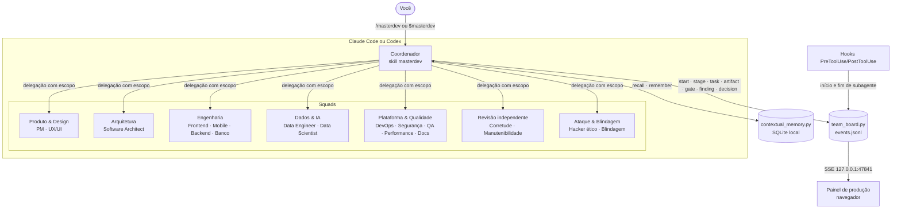
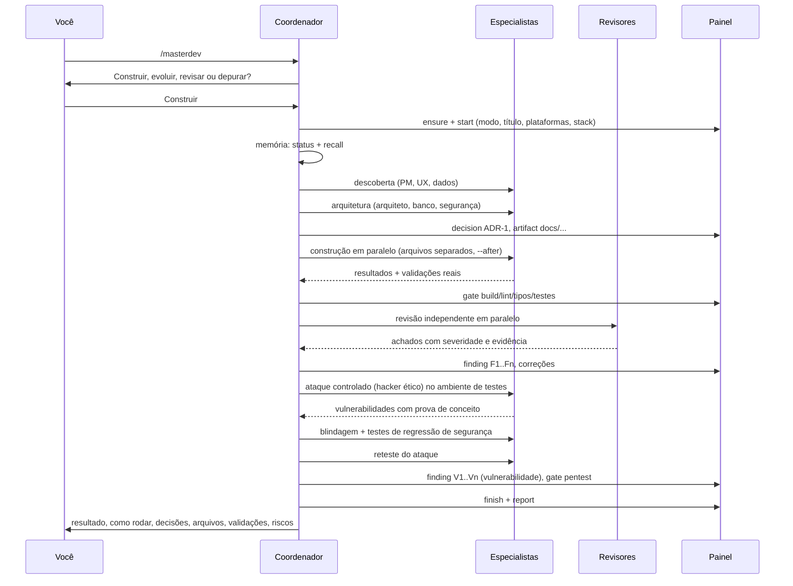

# Arquitetura

O Master Develops tem quatro peças: a **skill coordenadora**, os **18 agentes**, o **painel de produção** e a **memória contextual**. Tudo roda localmente, dentro do Claude Code ou do Codex, com Python da biblioteca padrão.

## Fluxo de uma missão

## Peças

| Peça | Onde | Responsabilidade |
|---|---|---|
| Skill coordenadora | `masterdev/skills/masterdev/SKILL.md` | Pergunta o modo, aplica princípios, escolhe especialistas, delega, integra e entrega |
| Playbooks | `references/PLAYBOOKS.md` | Passo a passo de construir, evoluir, revisar e depurar; núcleo sugerido por tipo de produto |
| Definição de pronto | `references/DEFINITION-OF-DONE.md` | Checklist antes da entrega |
| Equipe | `assets/team.json` → `agents/*.md`, `.codex/agents/*.toml` | Fonte única dos 18 especialistas |
| Painel | `scripts/team_board.py` + `assets/painel.html` | Eventos, estado, servidor SSE, hooks, relatório, demonstração |
| Memória | `scripts/contextual_memory.py` | Conhecimento persistente por operador e projeto |
| Instalador | `install.ps1`, `install.sh` → `scripts/install.py` | Copia skill e agentes, liga hooks, gera o painel |

## Decisões

- **Somente biblioteca padrão do Python** no que vai para a máquina do usuário: instala em qualquer lugar sem `pip`.
- **Eventos em JSONL, estado calculado na leitura:** nada se corrompe se dois processos escreverem ao mesmo tempo; eventos malformados são ignorados.
- **Servidor somente leitura em 127.0.0.1:** a escrita acontece só pela linha de comando local.
- **Uma fonte para a equipe:** `team.json` evita divergência entre Claude Code, Codex e painel.
- **Convivência:** o hook usa marcador próprio (`hook --app masterdev`) e o script instalado tem nome próprio (`masterdev_board.py`), para não colidir com o Master Data Engineer.
