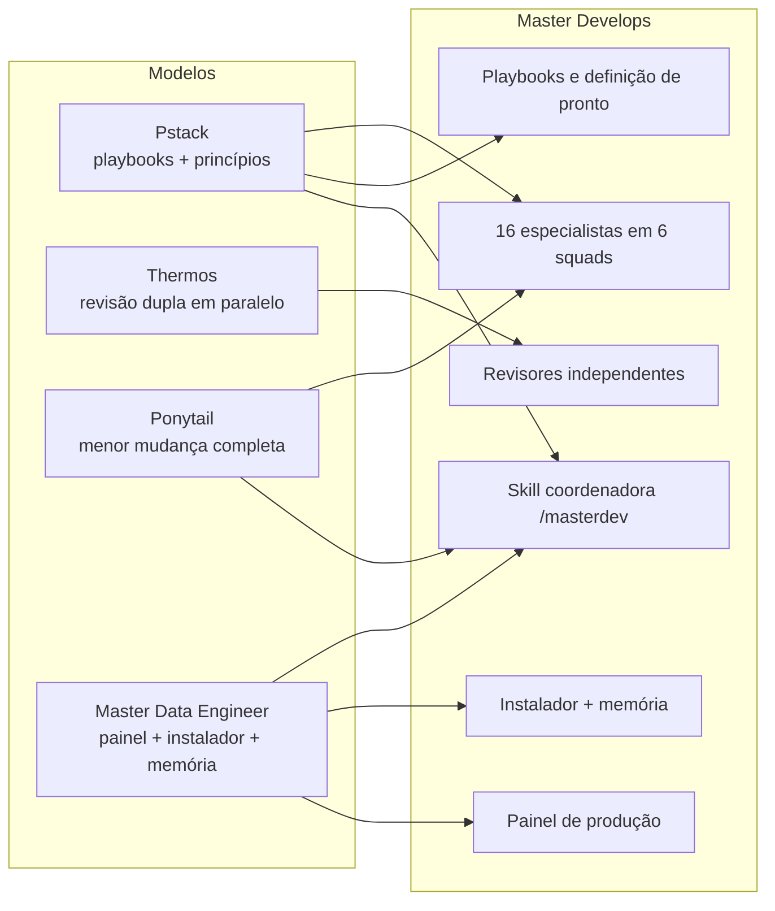

# Mapeamento dos modelos de referência

O Master Develops nasceu da leitura de quatro projetos: três modelos públicos de agentes de código (**Pstack**, **Thermos** e **Ponytail**) e o **Master Data Engineer**, do mesmo autor. Este documento mostra, item por item, o que cada um ensinou e onde isso foi parar na equipe de software e aplicativos.

Nenhum arquivo dos modelos foi copiado para este repositório. As ideias foram estudadas e reescritas para o contexto de produto digital (web, mobile, APIs, dados e IA).

## 1. Pstack — orquestração, playbooks e princípios

O Pstack transforma o agente em "uma equipe de engenharia de verdade": uma skill de entrada lê o pedido, escolhe um playbook, abre uma lista de passos e aciona outras skills conforme o passo exige. Traz também cerca de vinte princípios de engenharia.

| No Pstack | No Master Develops |
|---|---|
| Skill de modo (`poteto-mode`) que roteia para playbooks | Skill coordenadora `masterdev`: pergunta o modo e segue o playbook (`SKILL.md`, `references/PLAYBOOKS.md`) |
| Playbooks `feature`, `bug fix`, `refactoring`, `investigation`, `multi-phase plan` | 4 modos: **construir**, **evoluir** (feature + refatoração), **revisar**, **depurar** |
| `architect` — tipos, assinaturas e módulos antes do código | Agente `software-architect` + etapa "Arquitetura e design" + ADRs no painel (`decision`) |
| `swarm` / `arena` — paralelizar workers independentes | Regra de delegação: paralelizar só tarefas independentes, um escritor por conjunto de arquivos, dependências com `--after` |
| `interrogate` / revisão adversarial multi-modelo | Revisores independentes recebem o código e o pedido, não a conclusão do coordenador |
| `tdd`, `create-verification-skill` | Agente `qa-test-engineer`: teste que reproduz o bug primeiro; gates `testes`/`e2e` |
| `blast-radius` — o que a mudança quebra fora do diff | Instruções do `code-correctness-reviewer` e passo 2 do playbook *Evoluir* |
| `technical-writing`, `unslop` | Agente `technical-writer` (Diátaxis, frases curtas, voz ativa) e regra de resposta final em linguagem simples |
| `show-me-your-work` — trilha de decisões | Feed do painel, ADRs, relatório da missão em Markdown |
| `ketchup` — atualizar o humano sobre o que mudou | Painel ao vivo + faixa "Precisa de atenção" + avisos do navegador |
| Princípio *experience-first* | Princípio 6 da skill e agente `ux-ui-designer` (todos os estados de tela, WCAG 2.2 AA) |
| *model-the-domain*, *foundational-thinking* | Princípio 3: domínio e dados antes da interface; agentes `software-architect` e `database-engineer` |
| *boundary-discipline* | Validação e autorização nas bordas (princípio 7; `backend-engineer`, `security-engineer`) |
| *make-operations-idempotent* | `backend-engineer` (chaves de idempotência, upsert) e `data-engineer` (reprocessamento) |
| *sequence-verifiable-units* | Princípio 8 e passo "Plano" dos playbooks: unidades pequenas que terminam em algo testável |
| *prove-it-works* | Princípio 9 e gates do painel: só vale o que foi executado de verdade |
| *fix-root-causes*, *attack-the-premise* | Princípio 10 e playbook *Depurar* |
| *subtract-before-you-add*, *laziness-protocol* | Playbook *Evoluir* (remover o obsoleto primeiro) e `code-maintainability-reviewer` |
| *redesign-from-first-principles* | Playbook *Evoluir*: redesenhar a parte afetada quando o requisito não cabe |
| *test-behavior-not-implementation* | `qa-test-engineer` e `code-maintainability-reviewer` |
| *type-system-discipline* | `frontend-engineer` (tipos fortes) e `code-maintainability-reviewer` (estados inválidos) |
| *explain-the-number*, `benchmark-checklist` | `performance-engineer` (linha de base, repetições, explicar a variação) e `data-scientist` |
| *never-block-on-the-human* | Princípio 2: decisões reversíveis e de baixo risco seguem sem perguntar |
| *guard-the-context-window* | Delegação com escopo e contexto delimitados; relatórios curtos dos agentes |

## 2. Thermos — revisão dupla e independente

O Thermos roda dois revisores em paralelo sobre o diff e o conteúdo completo dos arquivos: um de corretude/segurança e outro de qualidade de código, e sintetiza os achados sem duplicatas.

| No Thermos | No Master Develops |
|---|---|
| `thermo-nuclear-review` (bugs, quebras, segurança, vazamentos) | `code-correctness-reviewer` (somente leitura) |
| `thermo-nuclear-code-quality-review` (manutenibilidade) | `code-maintainability-reviewer` (somente leitura) |
| Orquestrador `thermos` dispara os dois em paralelo | Etapa "Revisão independente" de todos os playbooks; os dois em paralelo |
| Síntese priorizada e sem duplicatas | Coordenador consolida; achados vão para o painel com severidade, local e status (`finding`) |

## 3. Ponytail — a menor mudança completa

O Ponytail é uma regra de "desenvolvedor sênior preguiçoso": resolver o problema inteiro com o mínimo de código novo, sem cortar segurança, validação ou acessibilidade.

| No Ponytail | No Master Develops |
|---|---|
| Escada: precisa existir? já existe no projeto? biblioteca padrão? dependência instalada? | Princípio 4 da skill ("a menor solução completa") com a mesma ordem |
| Preguiça na solução, nunca na mudança: atualizar chamadores, testes, fixtures | Princípio 4 e definição de pronto ("chamadores, contratos, migrations, testes e documentação") |
| Sem abstrações, opções ou código "para depois" | Instruções de todos os engenheiros e do `software-architect` |
| Nunca cortar: validação nas bordas, segurança, acessibilidade | Princípios 6 e 7; definição de pronto |
| Dizer o que ficou de fora | `product-manager` nomeia o fora de escopo; resposta final lista o que não foi verificado |

## 4. Master Data Engineer — a base operacional

| No Master Data Engineer | No Master Develops |
|---|---|
| Skill que pergunta o modo antes de agir | Mantido, com 4 modos em vez de 3 |
| 8 agentes Databricks | Substituídos por 16 especialistas de produto, design, engenharia, dados, IA, plataforma e revisão |
| Agentes mantidos à mão em dois formatos | **Fonte única** `team.json` + gerador `build_agents.py` |
| Painel da equipe (4 visões) | **Painel de produção** (6 visões, squads, gates, achados, ADRs, entregáveis, saúde, relatório) — ver `docs/painel.md` |
| Instalador de um comando | Mantido, com marcador de hook próprio e nome de script próprio para conviver com o MDE |
| Memória contextual SQLite | Mantida (`MASTERDEV_MEMORY_HOME`), isolada por projeto |

## O que não foi importado

- Comandos e recursos exclusivos do Cursor (bugbot, automations, custom modes) e nomes fixos de modelos.
- Benchmarks, alegações de desempenho e textos de divulgação dos projetos de origem.
- Regras específicas de TypeScript/React do Pstack como obrigação: a equipe segue a stack de cada projeto.
- Qualquer suposição de que deploy, publicação ou operações destrutivas são seguros sem autorização.

## Onde ficam as cópias dos modelos

As cópias completas (ZIPs originais e pastas extraídas) ficam **fora deste repositório**, na pasta local de construção do projeto (`Modelos/`), preservadas sem alteração. Fontes oficiais em `THIRD_PARTY_NOTICES.md`.
