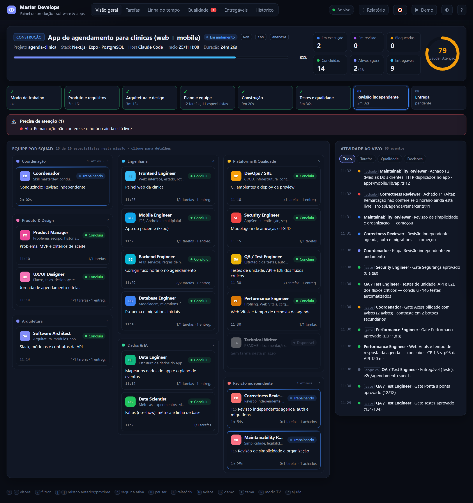
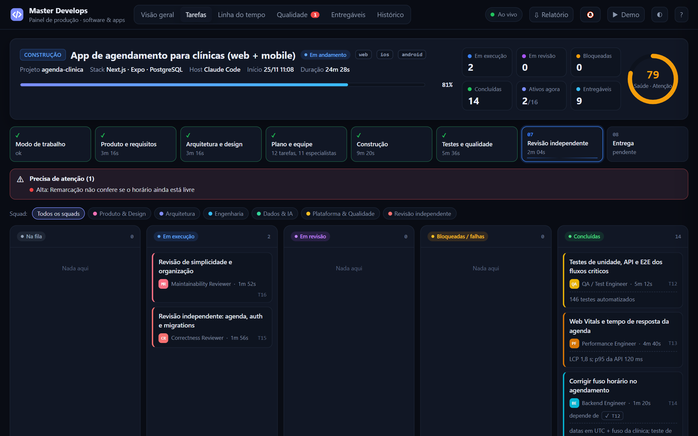
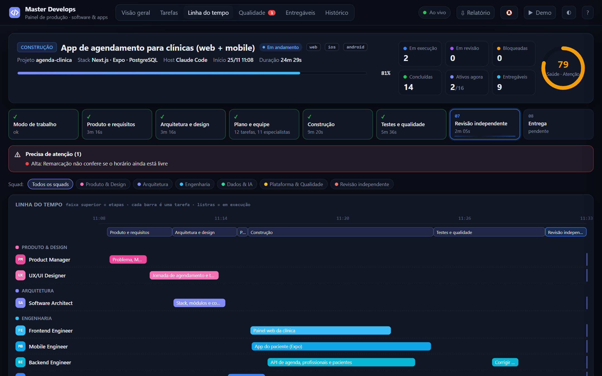
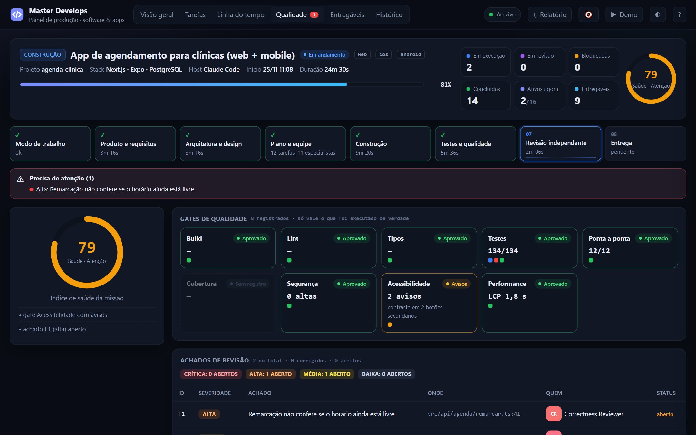
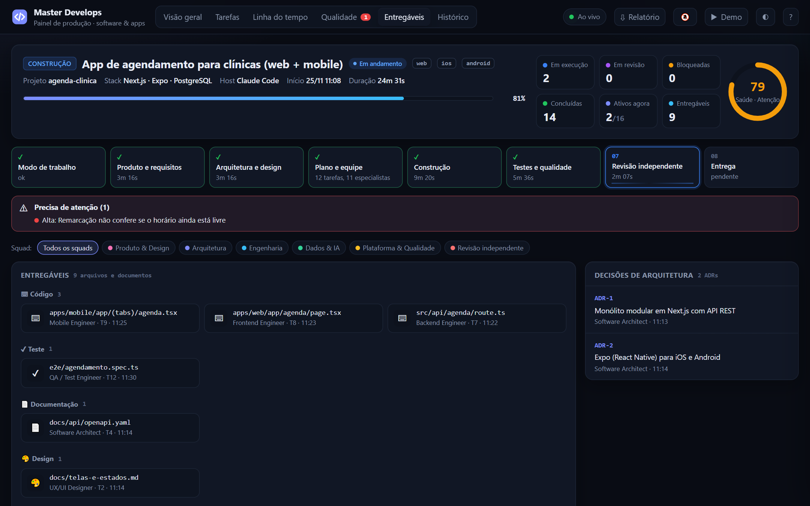

# Painel de produção

O painel mostra, em tempo real, o que a equipe está fazendo: a missão, as etapas, cada especialista, as tarefas e dependências, os entregáveis, os testes e verificações (gates), os achados das revisões, as decisões de arquitetura e um índice de saúde. Ele roda **só na sua máquina** (`http://127.0.0.1:47841`) e não envia nada para a internet.

## Como abrir

| Jeito | Como |
|---|---|
| Atalho da instalação | `~/MasterDevelops/Abrir painel.cmd` (Windows) ou `abrir-painel.sh` |
| Pelo agente | `/masterdev painel` (Claude Code) ou `$masterdev painel` (Codex) |
| Automático | Ao escolher o modo, a equipe sobe o painel e mostra o endereço |
| Terminal | `python ~/MasterDevelops/app/scripts/masterdev_board.py ensure --open` |
| Sem servidor | Abra `~/MasterDevelops/painel.html`: mostra a última foto salva e a demonstração |

Ainda sem missão? Tecle **D** para ver uma demonstração (missão fictícia de um app de agendamento web + mobile).

## As 6 visões

| Tecla | Visão | O que mostra |
|---|---|---|
| `1` | **Visão geral** | Missão, plataformas e stack, progresso, indicadores, índice de saúde, 8 etapas, faixa "Precisa de atenção", equipe agrupada por squad e atividade ao vivo com filtro (tarefas, qualidade, decisões) |
| `2` | **Tarefas** | Quadro em colunas (fila, em execução, em revisão, bloqueadas, concluídas) com dependências (`⏳ T4` aguardando, `✓ T4` concluída) e filtro por squad |
| `3` | **Linha do tempo** | Faixa das etapas no topo e uma linha por especialista, agrupada por squad; listras = em execução |
| `4` | **Qualidade** | Índice de saúde com os motivos, os 9 gates (build, lint, tipos, testes, ponta a ponta, cobertura, segurança, acessibilidade, performance) com histórico, e a tabela de achados por severidade e status |
| `5` | **Entregáveis** | Arquivos e documentos produzidos, agrupados por tipo (código, teste, documentação, design, infraestrutura, dados, configuração), e as decisões de arquitetura (ADRs) |
| `6` | **Histórico** | Métricas de produção (missões, taxa de sucesso, duração média, tarefas concluídas, entregáveis, achados corrigidos), missões por modo, especialistas mais acionados e a lista de missões com saúde |

Clique em qualquer especialista para abrir o **painel lateral** com as tarefas, os entregáveis, os achados e o tempo ativo dele.

| Tarefas | Linha do tempo |
|---|---|
|  |  |

| Qualidade | Entregáveis |
|---|---|
|  |  |

## Atalhos

| Tecla | Ação |
|---|---|
| `1`–`6` | Trocar de visão |
| `/` | Filtrar por texto (tarefas, entregáveis, achados, missões) |
| `[` `]` | Missão anterior / próxima |
| `A` | Voltar a seguir a missão ativa |
| `P` | Pausar / retomar as atualizações |
| `E` | Baixar o relatório da missão em Markdown |
| `N` | Ligar avisos do navegador (bloqueios, falhas, fim da missão) |
| `D` | Demonstração |
| `T` | Tema claro / escuro |
| `F` | Modo TV (tela cheia, para o telão do time) |
| `?` | Ajuda |
| `Esc` | Fechar painéis / limpar filtro |

Parâmetros de URL: `?view=quality`, `?theme=light`, `?demo=1`, `?agent=backend-engineer`.

## Índice de saúde

Começa em 100 e cai com problemas reais: gate reprovado (−15) ou com avisos (−5); achado aberto crítico (−25), alto (−12), médio (−4) ou baixo (−1); tarefa bloqueada (−6) ou com falha (−10); missão com falha (−20). **80+** Saudável, **55–79** Atenção, **abaixo de 55** Em risco. Corrigir um achado ou fazer um gate passar devolve os pontos na hora.

## O que mudou em relação ao painel do Master Data Engineer

| Master Data Engineer | Master Develops |
|---|---|
| 4 visões | 6 visões (+ Qualidade, + Entregáveis; Histórico com métricas) |
| 8 agentes em grade única | 16 especialistas agrupados em 6 squads, com filtro por squad |
| Tarefas soltas | Dependências entre tarefas (`--after`) com indicação de espera |
| — | Gates de qualidade com histórico, achados de revisão com severidade/status, ADRs, entregáveis por tipo |
| — | Índice de saúde 0–100 e faixa "Precisa de atenção" |
| — | Painel lateral por especialista (tarefas, entregáveis, achados, tempo ativo) |
| — | Relatório da missão em Markdown (`report`, tecla `E`, `/api/report.md`) |
| — | Avisos do navegador (tecla `N`) |
| Abas somem no celular | Abas roláveis no celular |
| — | Content-Security-Policy no servidor; detecção de mais formatos de credencial (OpenAI/Anthropic, Slack, Google, connection strings) |
| — | Hooks avançam a etapa conforme o papel do agente (nunca voltam) |

## Para quem integra: o protocolo

A equipe registra o andamento com comandos curtos (`start`, `stage`, `task`, `artifact`, `gate`, `finding`, `decision`, `note`, `finish`). Referência completa: [`BOARD-PROTOCOL.md`](../masterdev/skills/masterdev/references/BOARD-PROTOCOL.md).

API local (somente leitura): `GET /api/health`, `/api/state[?run=]`, `/api/stream` (Server-Sent Events), `/api/report.md[?run=]`, `/api/demo`.

## Privacidade

- Eventos em `~/MasterDevelops/board/events.jsonl`, só com textos curtos.
- Textos que parecem credenciais são trocados por um aviso antes de gravar; caminhos absolutos são encurtados.
- O servidor escuta apenas em `127.0.0.1` e é somente leitura.
- `team_board.py prune --keep 30` limpa missões antigas; o arquivo também é podado sozinho quando passa de 5 MB.
